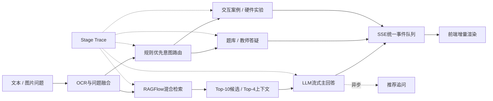

# 通信原理智能问答 Agent

面向高校通信原理教学场景的大模型应用：以 **RAGFlow 教材检索**为知识入口，通过
**规则优先的意图路由**编排题库、教师答疑、交互案例与硬件实验等业务服务，并使用
SSE 将主答案和业务结果流式返回。

这个仓库重点展示的不是一个聊天页面，而是一套可评测、可观测、可优化的 Agent 工程链路：
从真实知识库构造评测集，通过单变量消融冻结检索参数，再用阶段 Trace 和同题 A/B 测试定位
端到端长尾。

> 为保护教学资料及线上环境，本仓库为脱敏后的工程快照，不包含教材、教师真实答疑、会话、
> 密钥、内网地址和线上运行数据。核心编排、评测与分析代码均已保留。

## 项目成果

| 优化对象 | 基线 | 优化后 | 结果 |
|---|---:|---:|---:|
| Gold-dev 检索 Hit@4 | 86.7% | 93.3% | +6.6 pp |
| 冻结 Gold-test 检索 | — | Hit@4 85%、Hit@10 95% | MRR 0.816 |
| Prompt 平均 TTFT | 17.76 s | 7.81 s | -56.0% |
| Prompt 端到端时间 | 21.04 s | 11.05 s | -47.5% |
| 意图识别 P50 / P95 | 25.49 / 73.41 s | 0.078 / 0.185 ms | 消除额外LLM等待 |
| Agent完整流 P50 / P95 | 27.34 / 73.96 s | 10.87 / 29.01 s | 约降低60% |
| 普通问答无关Section | 111次 / 60题 | 0次 / 60题 | 消除误触发 |
| Agent黑盒成功率 | — | 60 / 60 | 100% |

冻结方案在未参与调参的20题Gold-test上完成最终验收。答案层RAG相对no-RAG的字符F1平均
提升0.204，19/20题提升；字符F1仅作为低成本筛查指标，语义正确性仍结合证据与人工抽查判断。

## 系统架构



项目采用“**确定性Workflow为主、LLM语义能力为辅**”的设计。路由、并发、超时、降级和停止
条件由代码控制，LLM主要负责知识增强回答和结构化参数抽取。这种方案比完全自主规划型Agent
更适合教学系统：执行路径稳定、业务边界清晰，也更容易进行回归测试和性能验收。

## 核心工作

### 1. RAG检索与参数消融

- 从RAGFlow只读导出两份教材的3794个真实Chunk，审计Book解析策略和Chunk长度分布。
- 自动生成300道候选题，经证据审查形成Gold 80、Silver 168、待复核52；Gold划分为
  dev 60 / test 20，避免使用最终测试集反复调参。
- 对相似度阈值、向量/关键词权重、候选规模和生成上下文进行单变量实验。
- 最终冻结 `0.6 × vector similarity + 0.4 × term similarity`；第一阶段保留Top-10，
  仅将Top-4送入LLM，控制上下文噪声和输入成本。
- Top-20没有增加召回，却将平均上下文从约354 Token提高到约1612 Token，因此没有盲目扩大上下文。

### 2. Agent路由与异步编排

- 将普通问答、题库、教师答疑、交互案例、硬件实验、其他课程实验和思政案例统一编排。
- 通过单一SSE事件队列按实际完成顺序推送Token、配置与业务Section，避免等待全部业务结束。
- 主回答结束发送 `answer_complete`，推荐追问通过独立接口异步生成，不再阻塞主Workflow。
- 辅助服务设置独立超时与降级：例如硬件参数抽取失败时返回空参数，但仍保留实验资源结果。

### 3. 意图识别优化

旧实现对每个请求调用一次LLM进行多标签分类。阶段Trace表明该节点P50达到25.49秒，并在60道
普通教材题上触发111个无关业务Section。

优化后使用高置信规则直接路由，普通问答只执行RAG主回答，明确请求专项资源时才调用对应模块；
同时保留 `INTENT_ROUTER_MODE=llm` 作为回滚与对照开关。该改动使完整流P50由27.34秒降至
10.87秒，而同题字符F1差值的95%区间跨0，未观察到系统性质量退化。

### 4. 上下文管理

早期版本直接加载最近20条消息，消息长度和Token开销不可控。当前增加了轻量上下文预算层：

- 按用户消息及其后续回答组织完整轮次；
- 默认最多保留10条消息、约1600 Token；
- 从最近轮次向前装载，优先保证指代和局部语境；
- 过滤空消息和异常角色，超长消息保留首尾并明确标记截断；
- 原始历史仍保存在会话服务中，不因请求侧压缩而被删除。

这是低风险的短期记忆优化，不额外调用摘要模型。后续可以演进为“最近完整轮次＋滚动摘要＋
结构化业务状态＋检索式长期记忆”，并通过事实保持率、任务成功率、Token与TTFT联合验收。

### 5. 可观测与评测闭环

系统分别记录 `rag`、`intent`、`llm_answer`、`business:*` 和 `workflow` 的start/end/error、
阶段耗时及请求ID。评测体系分为三层：

| 层级 | 主要指标 |
|---|---|
| 检索层 | Hit@K、Recall@K、Precision@K、MRR、nDCG |
| 答案层 | 正确性、字符F1、证据忠实度、配对胜负 |
| Agent层 | 成功率、TTFT、答案完成、完整流、P50/P95/P99、业务误触发 |

所有关键改动均采用同题配对，而不是比较两组无关样本；均值容易受到长尾影响，因此同时报告
中位数、P95/P99和Bootstrap置信区间。

## 多模态与硬件实验

- 图片问题先经过OCR，再与用户文本融合为统一问题，复用相同的路由、检索和生成链路。
- 实验分支从最近历史中抽取QPSK、DPSK等实体，结合语义相关度、时间位置和角色权重选择目标实验。
- 自然语言实验参数通过结构化抽取映射为硬件配置，再由TCP客户端发送至实验设备。
- `integrations/mcp_monitor.py` 使用 `MultiServerMCPClient` 完成远程MCP工具发现和设备健康检查。

边界说明：本仓库展示的是MCP客户端接入；`hardwareSet`仍是FastAPI/TCP服务，不将其包装成
“已完成的MCP Server”。写入硬件的生产级工具还应补充参数范围校验、幂等、权限和人工确认。

## 目录结构

```text
communication-agent/
├── tasks_distribute/
│   ├── tasks_distribute.py      # Agent入口、RAG、异步业务编排与SSE Trace
│   ├── intent_router.py         # 规则优先的多标签意图路由
│   └── context_manager.py       # 最近完整轮次与Token预算
├── evaluation/
│   ├── run_ragflow_baseline.py  # 检索层实验
│   ├── run_e2e_answer_eval.py   # no-RAG / RAG答案对照
│   ├── run_agent_e2e.py         # 完整Agent黑盒评测
│   └── analyze_*.py             # 指标聚合与配对分析
├── hardwareSet/                 # 实验参数抽取与设备TCP客户端
├── integrations/
│   └── mcp_monitor.py           # MCP工具发现与设备健康检查
└── .env.example                 # 脱敏配置模板
```

## 快速开始

### 环境配置

```powershell
Copy-Item .env.example .env
pip install -r tasks_distribute\requirements.txt
```

本地填写所需服务地址和凭据。`.env`已被Git忽略，禁止将真实密钥提交到仓库。

### 启动Agent入口

```powershell
$env:RAGFLOW_API_KEY = "your-local-key"
$env:INTENT_ROUTER_MODE = "rules"
python tasks_distribute\tasks_distribute.py
```

默认接口：`POST http://127.0.0.1:9450/tasks_distribute`。

完整运行还依赖RAGFlow、模型、OCR及业务服务；仓库不包含私有服务与教学数据。

### 运行单元测试

```powershell
python -m unittest discover -s evaluation -p "test_*.py"
```

### 完整Agent黑盒评测

评测集采用JSONL，每条记录至少包含：

```json
{"case_id":"example-1","question":"什么是QPSK？","reference_answer":"...","split":"dev"}
```

```powershell
python evaluation\run_agent_e2e.py `
  --cases path\to\gold.jsonl `
  --split dev `
  --agent-url http://127.0.0.1:9450/tasks_distribute `
  --output evaluation\output\agent_dev
```

## 工程取舍与后续方向

- **Rerank**：当前混合检索已通过冻结测试，尚未引入独立Reranker；后续应在固定候选集上比较
  排序增益、时延与成本后再决定是否上线。
- **长期记忆**：当前只做低风险短期预算；长期记忆需要写入准入、事实来源、冲突处理和用户删除能力。
- **Agent Skill**：路由、RAG、后端编排与评测已模块化，但尚未封装为正式 `SKILL.md` 包。
- **完整复现**：私有教材和后端服务不公开；仓库用于展示核心设计、优化方法与可复用评测链路。

## 安全说明

- 所有服务地址、账号和密钥通过环境变量注入。
- 教材、真实答疑、会话、日志和评测输出不进入Git。
- RAG文档和工具结果均视为不可信数据，不能覆盖系统指令。
- 对硬件配置等写操作，生产环境应启用权限、审批和审计。

